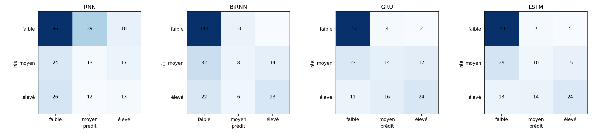
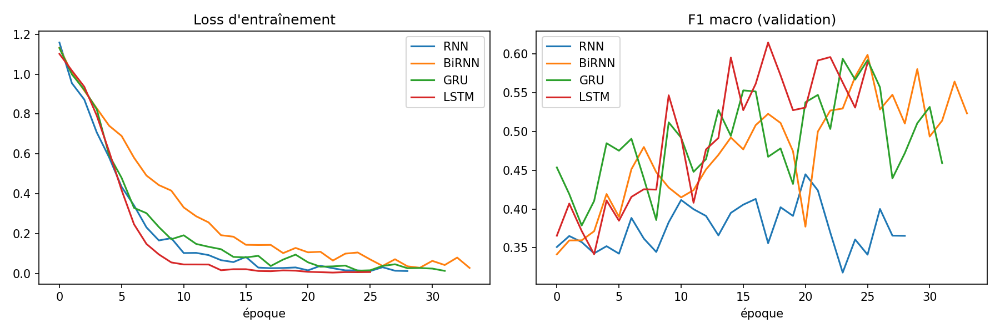

# Lab 3 – Deep Learning : NLP et modèles séquentiels (texte arabe)

**Université Abdelmalek Essaadi – FST Tanger**

**Module :** Deep Learning – Pr. Elaachak Lotfi

**Étudiante :** RAHELIARISOA Andriamasy Lorraine Agnès

## Objectif
Collecter un corpus de textes arabes sur un thème, lui associer un score de pertinence, le prétraiter,
entraîner et comparer des modèles séquentiels (RNN, BiRNN, GRU, LSTM), puis affiner GPT-2 pour
générer du texte.

## Contenu du dépôt
| Fichier | Rôle |
|---|---|
| `notebooks/01_scraping.ipynb` | scraping, score de pertinence, création du dataset |
| `notebooks/02_preprocessing.ipynb` | pipeline de prétraitement NLP |
| `notebooks/03_rnn_gru_lstm.ipynb` | RNN, BiRNN, GRU, LSTM : entraînement et évaluation |
| `notebooks/04_gpt2_generation.ipynb` | GPT-2 : fine-tuning et génération |
| `data/` | `dataset.csv` (texte, score), `articles_scored.csv`, `validation_sample.csv` |
| `results/` | métriques, courbes, matrices de confusion |

**Environnement :** Kaggle (GPU), PyTorch, BeautifulSoup, NLTK, pyarabic, qalsadi, scikit-learn.
Graine fixée à 42 (modèles : 42, 7 et 123).

---

# Partie 1 : Classification

## 1.1 Collecte des données et score de pertinence

**Thème :** l'intelligence artificielle et les nouvelles technologies en arabe
(الذكاء الاصطناعي والتكنologies).

**Sources.** Al Jazeera (aljazeera.net), DW Arabic (dw.com/ar) et Al Etihad (aletihad.ae).
BBC Arabic (aucun lien récupérable) et Al Araby Al-Jadeed (statut 403) étaient inaccessibles depuis
Kaggle et ont été abandonnés, sans contourner leur refus d'accès.

| Source | Articles | Remarque |
|---|---|---|
| Al Jazeera | 300 | dont 170 de la rubrique technologie |
| Al Etihad | 150 | actualité générale |
| DW Arabic | 120 | actualité générale (dont articles sur l'IA) |
| **Total** | **570** | articles uniques, collecte en novembre 2026 |

**Méthode.** `requests` et `BeautifulSoup` : lecture du `robots.txt`, pause de 1 à 2 s entre les requêtes,
découverte des liens depuis les pages de rubriques et d'accueil, puis exploration en cascade des articles
liés. Extraction des paragraphes en arabe de plus de 40 caractères, rejet des textes de moins de 300
caractères, dédoublonnage par URL et par titre. Longueur des textes : médiane 2 310 caractères
(min 304, max 22 818). Les rubriques générales (santé, sport, politique, climat...) fournissent les
textes peu pertinents, ce qui donne un gradient de scores de 0 à 10.

**Score de pertinence (0 à 10).** Le scraping ne fournit pas de score : il est calculé à partir d'un
lexique pondéré de termes arabes (normalisation des diacritiques et des alef, gestion des préfixes
و ف ب ك ل ال et des pluriels).

| Poids | Termes (exemples) |
|---|---|
| 3 | الذكاء الاصطناعي, التعلم الآلي, التعلم العميق, الشبكات العصبية, النماذج اللغوية, ChatGPT, OpenAI |
| 1,5 | تقنية, تكنولوجيا, خوارزمية, روبوت, حوسبة, سيبراني, برمجة, إنفيديا, غوغل, أندرويد, ويندوز |
| 0,5 (plafonné à 4) | رقمي, إلكتروني, إنترنت, هاتف |

Densité = 1000 × (somme pondérée des occurrences) / max(nombre de mots, 200), plus un bonus de 8 points
si un terme de poids 3 figure dans le titre (3 points pour un autre terme). Le score vaut
10 × (1 − exp(−brut / s)), arrondi à 0,5, avec `s` calibré pour que la médiane des articles
technologie d'Al Jazeera donne 7,5 (seule la rubrique sert à cette calibration d'échelle).
Un article sans terme de poids ≥ 1,5 est plafonné à 3.

**Validation.** Relecture d'un échantillon de 30 titres et de 8 vérifications ciblées. Une première
version surévaluait des textes sans rapport avec la technologie (calendrier d'examens à 8, sécurité
alimentaire à 9) : le lexique a été resserré (retrait des mots génériques comme « تطبيق » et
« ابتكار »), et ces cas sont revenus à 3.

| Titre (source) | Score |
|---|---|
| لماذا يحذّر باحثو الذكاء الاصطناعي من انقراض البشرية؟ (DW) | 10,0 |
| نسخة ثلاثية الأبعاد من متصفح سافاري (Al Jazeera) | 6,5 |
| دور الألعاب الإلكترونية في دعم الاقتصاد (Al Jazeera) | 5,0 |
| البرنامج الزمني لاختبارات نهاية الفصل الدراسي (Al Etihad) | 3,0 |

Répartition des scores : 337 articles dans [0 ; 2], 53 dans ]2 ; 4], 48 dans ]4 ; 6], 49 dans ]6 ; 8]
et 83 dans ]8 ; 10]. Le dataset final (`dataset.csv`) contient deux colonnes : `text` et `score`.

## 1.2 Pipeline de prétraitement

| Étape | Détail |
|---|---|
| Nettoyage | suppression des URL, diacritiques et tatwil ; alef (إأآٱ) → ا, ى → ي ; minuscules |
| Normalisation des nombres | tout nombre devient le jeton `num` ; ponctuation et symboles supprimés |
| Tokenisation | découpage sur les espaces, jetons de plus d'une lettre |
| Stop words | liste arabe de NLTK (normalisée) et `num` |
| Stemming | ISRI (NLTK) |
| Lemmatisation | `qalsadi` |
| Discrétisation | score → 3 classes : faible (≤ 2), moyen (2 à 6,5), élevé (> 6,5) |
| Découpage | stratifié 70 / 15 / 15 : 399 / 85 / 86 articles (graine 42) |
| Encodage | vocabulaire construit sur le train seul (fréquence ≥ 2, 20 000 mots max) : 7 762 entrées ; séquences de 256 jetons (remplissage et troncature) |

Longueur médiane par article : 374 jetons avant suppression des stop words, 286 après.

| Représentation | Taille du vocabulaire |
|---|---|
| Jetons (après nettoyage) | 40 369 |
| Après suppression des stop words | 40 025 |
| Stems (ISRI) | 8 987 |
| Lemmes (qalsadi) | 15 075 |

Le stemming réduit fortement le vocabulaire mais produit des racines parfois peu lisibles ;
la lemmatisation, plus fidèle aux mots, a été retenue pour les modèles (`lemmas`). Elle reste
imparfaite (certains mots gardent l'article « ال »).

Classes : faible 337, moyen 118, élevé 115 (déséquilibre traité par des poids de classes :
0,56 / 1,6 / 1,66). Longueur des séquences de lemmes : médiane 286, 75 % ≤ 489, 90 % ≤ 788,
maximum 2 799. Avec une longueur fixée à 256, **plus de la moitié des articles sont tronqués**.

## 1.3 Modèles séquentiels

Architecture commune : embedding (128, avec remplissage ignoré) → dropout → couche récurrente
(RNN, BiRNN, GRU ou LSTM, une seule couche, séquences compactées avec `pack_padded_sequence`) →
dernier état caché (concaténation des deux sens pour le BiRNN) → dropout → couche linéaire à 3 sorties.

**Entraînement.** Adam (weight decay 1e-5), perte d'entropie croisée pondérée par classe, lots de 32,
gradient clipping à 1, 40 époques maximum, arrêt anticipé (patience 8) sur le F1 macro de validation.

**Réglage des hyperparamètres.** Grille de 8 configurations par modèle (taille cachée 64 ou 128,
dropout 0,3 ou 0,5, taux d'apprentissage 1e-3 ou 3e-3), sélection sur le F1 macro de validation.

| Modèle | Taille cachée | Dropout | Taux d'apprentissage |
|---|---|---|---|
| RNN | 64 | 0,3 | 3e-3 |
| BiRNN | 128 | 0,5 | 1e-3 |
| GRU | 128 | 0,5 | 3e-3 |
| LSTM | 64 | 0,3 | 3e-3 |

Chaque meilleure configuration est ré-entraînée avec 3 graines (42, 7, 123) ; les résultats sont
des moyennes sur le jeu de test (86 articles).

## 1.4 Évaluation et comparaison

| Modèle | Accuracy | F1 macro (± écart-type) | Précision | Rappel | Acc. équilibrée | Kappa | MCC | Temps (s) | Paramètres |
|---|---|---|---|---|---|---|---|---|---|
| RNN | 0,473 | 0,377 (± 0,066) | 0,394 | 0,374 | 0,374 | 0,089 | 0,092 | 2,9 | 1 006 147 |
| BiRNN | 0,671 | 0,507 (± 0,037) | 0,556 | 0,509 | 0,509 | 0,343 | 0,372 | 7,2 | 1 060 355 |
| **GRU** | **0,717** | **0,565 (± 0,032)** | 0,589 | 0,564 | 0,564 | 0,459 | 0,471 | 5,2 | 1 092 995 |
| LSTM | 0,678 | 0,521 (± 0,037) | 0,528 | 0,526 | 0,526 | 0,382 | 0,394 | 4,4 | 1 043 395 |
| *Toujours « faible »* | 0,593 | 0,248 | | | | | | | |
| *TF-IDF + régression logistique* | *0,826* | *0,741* | | | | | | | |

Le temps est la durée moyenne d'un entraînement avec arrêt anticipé ; le nombre de paramètres
varie avec la taille cachée retenue (64 ou 128), pas seulement avec l'architecture.

**Score BLEU** (calculé sur la suite des labels prédits, voir réserve ci-dessous) :

| Modèle | BLEU-1 | BLEU-2 |
|---|---|---|
| RNN | 0.9612 | 0.9133 |
| BiRNN | 0.8333 | 0.7745 |
| GRU | 0.8915 | 0.8474 |
| LSTM | 0.8837 | 0.8416 |

**Analyse.**

- **Le GRU obtient la meilleure moyenne** (F1 macro 0,565, kappa 0,459), mais son avance sur le LSTM
  et le BiRNN n'est pas significative : avec 86 articles de test, l'incertitude sur l'accuracy est
  d'environ ± 5 points, plus que ces écarts. L'écart-type sur 3 graines ne mesure que l'aléa de
  l'initialisation, pas celui du petit jeu de test.
- **Le RNN simple est nettement le moins bon** (kappa 0,089, proche du hasard) et le plus instable
  (± 0,066) : son accuracy (0,473) est même inférieure à celle d'un modèle qui prédit toujours
  « faible » (0,593). Sur des séquences de 256 pas, le gradient de ce réseau s'évanouit, ce que les
  portes du GRU et du LSTM atténuent. Le BiRNN fait mieux car il lit le texte dans les deux sens.
- **La classe « faible » est bien reconnue, la classe « moyen » est la plus difficile** (rapport par
  classe : cellule 7 du notebook 03). Les classes moyen et élevé sont peu nombreuses (83 et 80 articles
  d'entraînement) et la frontière du score entre elles est arbitraire.
- **Une régression logistique sur sac de mots bat tous les RNN** (accuracy 0,826 contre 0,717 pour le
  meilleur ; F1 0,741 contre 0,565). Ce n'est pas surprenant : le score est calculé à partir de la
  fréquence de termes précis, qu'un modèle linéaire sur les mots capte directement, alors que les RNN,
  partant d'embeddings aléatoires sur 399 articles, doivent les redécouvrir. Un bon score de ces RNN ne
  prouverait donc pas qu'ils « comprennent » la pertinence.
- **BLEU est peu informatif ici.** C'est une métrique de génération ; appliquée à une suite de labels,
  elle dépend de l'ordre des articles et ne reflète pas la qualité (le BiRNN est premier en BLEU-1 alors
  que le GRU l'est en accuracy et en F1). Elle est donnée parce que l'énoncé la demande ; elle sera
  utilisée à bon escient en partie 2. Les métriques à retenir sont le F1 macro, le kappa et le MCC.

**Limites.**

- Corpus petit (570 articles) et test de 86 articles seulement ; une validation croisée donnerait des
  comparaisons plus fiables.
- Le score vient d'un lexique, donc il est partiellement circulaire et ne mesure que la proximité
  « technologie et IA » (les noms de produits comptent fortement).
- Les classes élevées viennent surtout de la rubrique technologie d'Al Jazeera : les modèles peuvent
  s'appuyer sur le style de la source plutôt que sur le contenu.
- Les textes sont tronqués à 256 jetons alors que le score est calculé sur l'article entier ;
  l'effet de cette troncature n'a pas été mesuré (une longueur de 512 est une piste).

**Pistes d'amélioration.** Agrégation (moyenne ou maximum) des états cachés au lieu du dernier état,
séquences plus longues, embeddings arabes pré-entraînés (AraVec, fastText) ou fine-tuning d'AraBERT,
validation croisée, régression directe sur le score.

# Partie 2 : GPT-2 (génération de texte)
_À compléter._

# Synthèse personnelle
_À compléter à la fin du lab._
