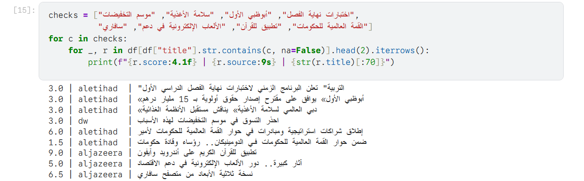

# Lab 3 – Deep Learning : NLP et modèles séquentiels (texte arabe)

**Université Abdelmalek Essaadi – FST Tanger**

**Module :** Deep Learning – Pr. Elaachak Lotfi

**Étudiante :** RAHELIARISOA Andriamasy Lorraine Agnès

## Objectif
Collecter un corpus de textes arabes sur un thème, lui associer un score de pertinence, le prétraiter,
entraîner et comparer des modèles séquentiels (RNN, BiRNN, GRU, LSTM), puis affiner un modèle de type
GPT-2 pour générer du texte.

## Contenu du dépôt
| Fichier | Rôle |
|---|---|
| `notebooks/01-scraping.ipynb` | scraping, score de pertinence, création du dataset |
| `notebooks/02-preprocessing.ipynb` | pipeline de prétraitement NLP |
| `notebooks/03-rnn-gru-lstm.ipynb` | RNN, BiRNN, GRU, LSTM : entraînement et évaluation |
| `notebooks/04-gpt2-generation.ipynb` | AraGPT2 : fine-tuning et génération |
| `data/dataset.csv` | dataset final : colonnes `text` et `score` |
| `data/articles_dedup.csv` | articles collectés (source, rubrique, titre, texte...), dédoublonnés |
| `data/articles_scored.csv` | articles avec leurs scores |
| `data/validation_sample.csv` | échantillon de 30 articles pour la relecture du score |
| `data/dataset_preprocessed.pkl`, `data/prep_data.pt` | données prétraitées (jetons, lemmes, classes) et séquences encodées |
| `results/` | métriques (`test_metrics.csv`, `grid_search.csv`, `bleu.csv`, `results_gpt2.json`), courbes, matrices de confusion |
| `requirements.txt` | bibliothèques Python utilisées |

**Environnement :** Kaggle (GPU), PyTorch, BeautifulSoup, NLTK, pyarabic, qalsadi, scikit-learn,
transformers. Graine fixée à 42 (modèles séquentiels : 42, 7 et 123).

**Notes.** Les poids d'AraGPT2 affiné (environ 550 Mo) ne sont pas versionnés : le notebook 04 permet de
les régénérer. Les textes proviennent d'articles de presse (Al Jazeera, DW, Al Etihad) collectés à des
fins pédagogiques ; ils restent la propriété de leurs éditeurs et ne doivent pas être redistribués.

---

# Partie 1 : Classification

## 1.1 Collecte des données et score de pertinence

**Thème :** l'intelligence artificielle et les nouvelles technologies en arabe
(الذكاء الاصطناعي والتكنولوجيا).

**Sources.** Al Jazeera (aljazeera.net), DW Arabic (dw.com/ar) et Al Etihad (aletihad.ae).
BBC Arabic (aucun lien récupérable) et Al Araby Al-Jadeed (statut 403) étaient inaccessibles depuis
Kaggle et ont été abandonnés, sans contourner leur refus d'accès.

| Source | Articles | Remarque |
|---|---|---|
| Al Jazeera | 300 | dont 170 de la rubrique technologie |
| Al Etihad | 150 | actualité générale |
| DW Arabic | 120 | actualité générale (dont articles sur l'IA) |
| **Total** | **570** | articles uniques, collecte en novembre 2026 |

**Méthode.** `requests` et `BeautifulSoup` : lecture du `robots.txt`, pause de 1 à 2 s entre les requêtes,
découverte des liens depuis les pages de rubriques et d'accueil, puis exploration en cascade des articles
liés. Extraction des paragraphes en arabe de plus de 40 caractères, rejet des textes de moins de 300
caractères, dédoublonnage par URL et par titre. Longueur des textes : médiane 2 310 caractères
(min 304, max 22 818). Les rubriques générales (santé, sport, politique, climat...) fournissent les
textes peu pertinents, ce qui donne un gradient de scores de 0 à 10.

**Score de pertinence (0 à 10).** Le scraping ne fournit pas de score : il est calculé à partir d'un
lexique pondéré de termes arabes (normalisation des diacritiques et des alef, gestion des préfixes
و ف ب ك ل ال et des pluriels).

| Poids | Termes (exemples) |
|---|---|
| 3 | الذكاء الاصطناعي, التعلم الآلي, التعلم العميق, الشبكات العصبية, النماذج اللغوية, ChatGPT, OpenAI |
| 1,5 | تقنية, تكنولوجيا, خوارزمية, روبوت, حوسبة, سيبراني, برمجة, إنفيديا, غوغل, أندرويد, ويندوز |
| 0,5 (plafonné à 4) | رقمي, إلكتروني, إنترنت, هاتف |

Densité = 1000 × (somme pondérée des occurrences) / max(nombre de mots, 200), plus un bonus de 8 points
si un terme de poids 3 figure dans le titre (3 points pour un autre terme). Le score vaut
10 × (1 − exp(−brut / s)), arrondi à 0,5, avec `s` calibré pour que la médiane des articles
technologie d'Al Jazeera donne 7,5 (seule la rubrique sert à cette calibration d'échelle).
Un article sans terme de poids ≥ 1,5 est plafonné à 3.

**Validation.** Relecture d'un échantillon de 30 titres et de 8 vérifications ciblées. Une première
version surévaluait des textes sans rapport avec la technologie (calendrier d'examens à 8, sécurité
alimentaire à 9). Le lexique et la formule ont été resserrés (retrait des mots génériques comme « تطبيق »
et « ابتكار », plafond sur les termes faibles, plancher de 200 mots, plafond à 3 sans terme fort), et ces
cas sont revenus à 3.

| Titre (source) | Score |
|---|---|
| لماذا يحذّر باحثو الذكاء الاصطناعي من انقراض البشرية؟ (DW) | 10,0 |
| نسخة ثلاثية الأبعاد من متصفح سافاري (Al Jazeera) | 6,5 |
| دور الألعاب الإلكترونية في دعم الاقتصاد (Al Jazeera) | 5,0 |
| البرنامج الزمني لاختبارات نهاية الفصل الدراسي (Al Etihad) | 3,0 |

Répartition des scores : 337 articles dans [0 ; 2], 53 dans ]2 ; 4], 48 dans ]4 ; 6], 49 dans ]6 ; 8]
et 83 dans ]8 ; 10]. Le dataset final (`dataset.csv`) contient deux colonnes : `text` et `score`.

## 1.2 Pipeline de prétraitement

| Étape | Détail |
|---|---|
| Nettoyage | suppression des URL, diacritiques et tatwil ; alef (إأآٱ) → ا, ى → ي ; minuscules |
| Normalisation des nombres | tout nombre devient le jeton `num` ; ponctuation et symboles supprimés |
| Tokenisation | découpage sur les espaces, jetons de plus d'une lettre |
| Stop words | liste arabe de NLTK (normalisée) et `num` |
| Stemming | ISRI (NLTK) |
| Lemmatisation | `qalsadi` |
| Discrétisation | score → 3 classes : faible (≤ 2), moyen (2 à 6,5), élevé (> 6,5) |
| Découpage | stratifié 70 / 15 / 15 : 399 / 85 / 86 articles (graine 42) |
| Encodage | vocabulaire construit sur le train seul (fréquence ≥ 2, 20 000 mots max) : 7 762 entrées ; séquences de 256 jetons (remplissage et troncature) |

Longueur médiane par article : 374 jetons avant suppression des stop words, 286 après.

| Représentation | Taille du vocabulaire |
|---|---|
| Jetons (après nettoyage) | 40 369 |
| Après suppression des stop words | 40 025 |
| Stems (ISRI) | 8 987 |
| Lemmes (qalsadi) | 15 075 |

Le stemming réduit fortement le vocabulaire mais produit des racines parfois peu lisibles ;
la lemmatisation, plus fidèle aux mots, a été retenue pour les modèles (`lemmas`). Elle reste
imparfaite (certains mots gardent l'article « ال »).

Classes : faible 337, moyen 118, élevé 115 (déséquilibre traité par des poids de classes :
0,56 / 1,6 / 1,66). Longueur des séquences de lemmes : médiane 286, 75 % ≤ 489, 90 % ≤ 788,
maximum 2 799. Avec une longueur fixée à 256, **plus de la moitié des articles sont tronqués**.

## 1.3 Modèles séquentiels

Architecture commune : embedding (128, avec remplissage ignoré) → dropout → couche récurrente
(RNN, BiRNN, GRU ou LSTM, une seule couche, séquences compactées avec `pack_padded_sequence`) →
dernier état caché (concaténation des deux sens pour le BiRNN) → dropout → couche linéaire à 3 sorties.

**Entraînement.** Adam (weight decay 1e-5), perte d'entropie croisée pondérée par classe, lots de 32,
gradient clipping à 1, 40 époques maximum, arrêt anticipé (patience 8) sur le F1 macro de validation.

**Réglage des hyperparamètres.** Grille de 8 configurations par modèle (taille cachée 64 ou 128,
dropout 0,3 ou 0,5, taux d'apprentissage 1e-3 ou 3e-3), sélection sur le F1 macro de validation.

| Modèle | Taille cachée | Dropout | Taux d'apprentissage |
|---|---|---|---|
| RNN | 64 | 0,3 | 3e-3 |
| BiRNN | 128 | 0,5 | 1e-3 |
| GRU | 128 | 0,5 | 3e-3 |
| LSTM | 64 | 0,3 | 3e-3 |

Chaque meilleure configuration est ré-entraînée avec 3 graines (42, 7, 123) ; les résultats sont
des moyennes sur le jeu de test (86 articles).

## 1.4 Évaluation et comparaison

| Modèle | Accuracy | F1 macro (± écart-type) | Précision | Rappel | Acc. équilibrée | Kappa | MCC | Temps (s) | Paramètres |
|---|---|---|---|---|---|---|---|---|---|
| RNN | 0,473 | 0,377 (± 0,066) | 0,394 | 0,374 | 0,374 | 0,089 | 0,092 | 2,9 | 1 006 147 |
| BiRNN | 0,671 | 0,507 (± 0,037) | 0,556 | 0,509 | 0,509 | 0,343 | 0,372 | 7,2 | 1 060 355 |
| **GRU** | **0,717** | **0,565 (± 0,032)** | 0,589 | 0,564 | 0,564 | 0,459 | 0,471 | 5,2 | 1 092 995 |
| LSTM | 0,678 | 0,521 (± 0,037) | 0,528 | 0,526 | 0,526 | 0,382 | 0,394 | 4,4 | 1 043 395 |
| *Toujours « faible »* | 0,593 | 0,248 | | | | | | | |
| *TF-IDF + régression logistique* | *0,826* | *0,741* | | | | | | | |

Le temps est la durée moyenne d'un entraînement avec arrêt anticipé ; le nombre de paramètres
varie avec la taille cachée retenue (64 ou 128), pas seulement avec l'architecture.

**Score BLEU** (calculé sur la suite des étiquettes prédites, cumulées sur les 3 graines, soit
3 × 86 étiquettes ; voir la réserve ci-dessous) :

| Modèle | BLEU-1 | BLEU-2 |
|---|---|---|
| RNN | 0,961 | 0,913 |
| BiRNN | 0,833 | 0,775 |
| GRU | 0,892 | 0,847 |
| LSTM | 0,884 | 0,842 |

Les matrices de confusion et les rapports par classe cumulent également les 3 graines.

**Analyse.**

- **Le GRU obtient la meilleure moyenne** (F1 macro 0,565, kappa 0,459), mais son avance sur le LSTM
  et le BiRNN n'est pas significative : avec 86 articles de test, l'incertitude sur l'accuracy est
  d'environ ± 5 points, plus que ces écarts. L'écart-type sur 3 graines ne mesure que l'aléa de
  l'initialisation, pas celui du petit jeu de test.
- **Le RNN simple est nettement le moins bon** (kappa 0,089, proche du hasard) et le plus instable
  (± 0,066) : son accuracy (0,473) est même inférieure à celle d'un modèle qui prédit toujours
  « faible » (0,593). Cela s'explique probablement par l'évanouissement du gradient sur des séquences
  de 256 pas, que les portes du GRU et du LSTM atténuent. Le BiRNN fait mieux, probablement parce qu'il
  lit le texte dans les deux sens (sa configuration retenue est aussi plus grande : 128 unités contre 64).
- **La classe « faible » est bien reconnue, la classe « moyen » est la plus difficile** (rapport par
  classe : cellule 7 du notebook 03). Les classes moyen et élevé sont peu nombreuses (83 et 80 articles
  d'entraînement) et la frontière du score entre elles est arbitraire.
- **Une régression logistique sur sac de mots bat tous les RNN** (accuracy 0,826 contre 0,717 pour le
  meilleur ; F1 0,741 contre 0,565). Ce n'est pas surprenant : le score est calculé à partir de la
  fréquence de termes précis, qu'un modèle linéaire sur les mots capte directement, alors que les RNN,
  partant d'embeddings aléatoires sur 399 articles, doivent les redécouvrir. Un bon score de ces RNN ne
  prouverait donc pas qu'ils « comprennent » la pertinence.
- **BLEU est peu informatif ici.** C'est une métrique de génération ; appliquée à une suite
  d'étiquettes, elle dépend de l'ordre des articles et ne reflète pas la qualité : le RNN simple,
  pourtant le moins bon sur toutes les autres métriques, obtient le meilleur BLEU (BLEU-1 0,961), et
  le BiRNN le plus bas (0,833). Elle est donnée parce que l'énoncé la demande. Les métriques à retenir
  sont le F1 macro, le kappa et le MCC ; en partie 2, BLEU est appliqué à du texte généré, ce qui est
  son usage normal.

**Limites.**

- Corpus petit (570 articles) et test de 86 articles seulement ; une validation croisée donnerait des
  comparaisons plus fiables.
- Le score vient d'un lexique, donc il est partiellement circulaire et ne mesure que la proximité
  « technologie et IA » (les noms de produits comptent fortement).
- Les classes élevées semblent venir surtout de la rubrique technologie d'Al Jazeera (non vérifié) : les
  modèles peuvent s'appuyer sur le style de la source plutôt que sur le contenu.
- Les textes sont tronqués à 256 jetons alors que le score est calculé sur l'article entier ;
  l'effet de cette troncature n'a pas été mesuré (une longueur de 512 est une piste).

**Pistes d'amélioration.** Agrégation (moyenne ou maximum) des états cachés au lieu du dernier état,
séquences plus longues, embeddings arabes pré-entraînés (AraVec, fastText) ou fine-tuning d'AraBERT,
validation croisée, régression directe sur le score.

---

# Partie 2 : GPT-2 (génération de texte)

## 2.1 Modèle
**AraGPT2-base** (`aubmindlab/aragpt2-base`) : un modèle de l'architecture GPT-2 (12 couches,
12 têtes d'attention, dimension 768, contexte de 1024 jetons, **134 994 432 paramètres**), pré-entraîné
sur un grand corpus arabe. Le GPT-2 d'origine étant entraîné sur de l'anglais, il est peu adapté à un
corpus arabe ; AraGPT2 garde la même architecture, seul le pré-entraînement change.
Il est chargé avec `GPT2LMHeadModel` et `GPT2TokenizerFast` de la bibliothèque `transformers`
(successeur de `pytorch-transformers`).

## 2.2 Dataset personnalisé
Le corpus de la partie 1 est réutilisé : les **115 articles de score ≥ 6,5** (classe « élevé ») sur 570,
soit 104 articles d'entraînement et 11 de validation. Les textes sont tokenisés avec le tokenizer du
modèle, concaténés (jeton de fin entre les articles) et découpés en blocs de 256 jetons :
236 blocs d'entraînement (60 416 jetons) et 30 blocs de validation (7 680 jetons).

## 2.3 Fine-tuning
| Paramètre | Valeur |
|---|---|
| Optimiseur | AdamW, taux d'apprentissage 5e-5, weight decay 0,01 |
| Planification | warm-up sur 10 % des pas puis décroissance linéaire |
| Époques / lot | 3 / 4 blocs (177 pas au total) |
| Autres | gradient clipping à 1, précision mixte (fp16) |
| Matériel / durée | GPU Kaggle, 29 s |

| Époque | Loss d'entraînement | Perplexité (validation) | Temps cumulé |
|---|---|---|---|
| avant fine-tuning | | 228,3 | |
| 1 | 7,183 | 107,4 | 10 s |
| 2 | 5,388 | 79,6 | 20 s |
| 3 | 4,965 | **72,8** | 29 s |

La perplexité de validation baisse de 68 % (228,3 → 72,8). La loss d'entraînement est supérieure à
celle de validation car elle est moyennée sur l'époque, avec dropout actif ; sa valeur élevée à la
première époque (7,18) indique un démarrage un peu instable, avant que le modèle ne se stabilise.

## 2.4 Génération de texte
Paramètres : échantillonnage (top-p 0,92, top-k 50, température 0,8), pénalité de répétition 1,2,
répétition de 3-grammes interdite, 120 jetons générés.

| Phrase de départ | Avant fine-tuning | Après fine-tuning |
|---|---|---|
| يشهد قطاع الذكاء الاصطناعي تطورا متسارعا | ، حيث باتت الشركات تركز على تقديم ابتكارات جديدة في مجال الأجهزة الذكية... | في عدد الأجهزة العاملة بنظام التشغيل، حيث شهد نموا كبيرا خلال السنوات الماضية بنسبة 15%... |
| تعمل الشركات التقنية على تطوير نماذج لغوية | تقوم بإرجاعها إلى حالتها الأصلية في حين أن النموذج الأصلي لا يبدو جيدا... | جديدة تتيحها إمكانية الاستخدام الآلي. وتقول الباحثة... إن شركة مايكروسوفت تعمل حاليا في تطوير نظام ذكاء اصطناعي جديد... |

Les trois paragraphes complets, avant et après, sont dans `results/results_gpt2.json`.

**Observations.**
- **Thème et style.** Après fine-tuning, les trois textes restent dans le sujet (IA, entreprises
  technologiques, transformation numérique) et adoptent le style journalistique des articles
  (« وأشار », « وأضافت », « ويؤكد خبراء »). Avant, le modèle dérive parfois : pour la deuxième phrase,
  il produit une liste d'outils de « résolution de problèmes » sans rapport avec les modèles de langage.
- **Défauts.** Les textes contiennent des informations **inventées** (noms de personnes et de sociétés,
  chiffres, dates, sources), des mots déformés (par exemple « بالناتجانية »), un symbole parasite et
  des caractères « � » : le tokenizer fonctionne sur des octets, et certains caractères arabes générés
  sont décodés de façon incomplète. Ces paragraphes illustrent la génération et ne doivent pas être pris
  pour des informations fiables.

## 2.5 Évaluation
| Métrique | Avant fine-tuning | Après fine-tuning |
|---|---|---|
| Perplexité (validation) | 228,3 | **72,8** |
| BLEU-1 | 0,070 | 0,080 |
| BLEU-2 | 0,019 | 0,018 |

BLEU est calculé sur les 11 articles de validation : le modèle reçoit les 30 premiers jetons de
l'article et doit générer les 60 suivants (décodage glouton), comparés au texte réel (mots séparés
par les espaces, lissage de NLTK).

**Interprétation.** La perplexité s'améliore nettement, donc le modèle prédit mieux le vocabulaire et le
style du corpus. En revanche, BLEU ne change pas : un texte généré peut être correct sans reprendre les
mêmes mots que l'article réel, et l'arabe, où les articles et prépositions se collent aux mots, rend la
correspondance exacte encore plus rare. Avec 11 articles, les écarts de BLEU ne sont pas
interprétables.

## 2.6 Limites
- **Corpus minuscule** (104 articles, environ 60 000 jetons) et validation sur 11 articles : la
  perplexité est peu fiable. Des articles de validation peuvent aussi ressembler à des articles
  d'entraînement (articles liés, même événement), ce qui améliore artificiellement le résultat.
- **Préparation des textes.** Le modèle a été pré-entraîné sur des textes préparés avec
  `ArabertPreprocessor`, non utilisé ici : une partie de la perplexité initiale et de sa baisse
  peut venir d'un changement de format plutôt que de contenu.
- **Une seule exécution** (graine 42) et un seul échantillon généré par phrase ; aucune évaluation
  humaine de la qualité ni de la factualité.
- **Démarrage instable** de l'entraînement (loss moyenne de la première époque supérieure à la loss
  initiale de validation) : un taux d'apprentissage plus bas (2e-5) serait à essayer.

**Pistes.** Appliquer `ArabertPreprocessor`, utiliser les 570 articles (ou davantage) avec une
validation par article indépendant, tester `aragpt2-medium`, comparer plusieurs stratégies de
décodage et évaluer les textes à la main (cohérence, factualité).

---

# Synthèse personnelle
Ce lab m'a fait parcourir toute la chaîne du traitement de la langue arabe, de la collecte des
données à la génération de texte.

**Données.** J'ai appris que la collecte est la partie la moins prévisible : deux sites sur cinq
étaient inaccessibles depuis Kaggle, et j'ai dû respecter leur refus et en choisir d'autres. J'ai aussi
compris que fabriquer un score de pertinence est un choix méthodologique : mon score vient d'un
lexique pondéré, ce qui rend les résultats des modèles partiellement circulaires.

**Prétraitement.** J'ai vu en pratique les spécificités de l'arabe (diacritiques, variantes
d'alef, préfixes collés aux mots) et comparé le stemming (vocabulaire de 8 987 racines, parfois
illisibles) à la lemmatisation (15 075 lemmes, plus fidèles).

**Modèles séquentiels.** Le GRU est le meilleur RNN (F1 macro 0,565), le RNN simple est proche du
hasard, mais surtout une régression logistique sur sac de mots (F1 0,741) les bat tous. J'en retiens
qu'il faut toujours comparer à une baseline simple, et qu'avec 86 articles de test les écarts entre
GRU, LSTM et BiRNN ne sont pas significatifs. J'ai aussi vu que BLEU n'a pas de sens pour de la
classification.

**GPT-2.** Le fine-tuning d'AraGPT2 a réduit la perplexité de 228 à 73 et rapproché le style de celui
des articles, mais le texte généré invente des noms et des chiffres : un modèle de langage produit du
texte plausible, pas du texte vrai.

Dans l'ensemble, j'ai surtout appris à interpréter mes résultats avec prudence (petits jeux de test,
limites des métriques) plutôt qu'à chercher le meilleur chiffre.
